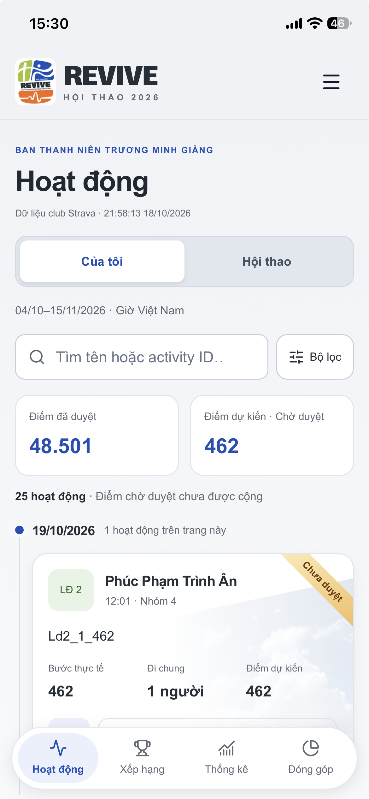
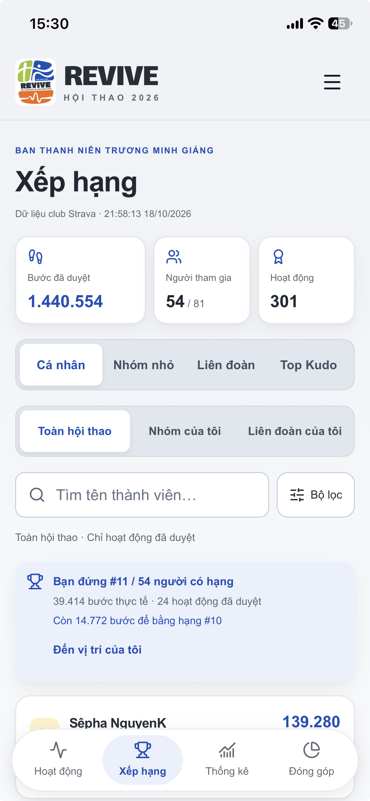
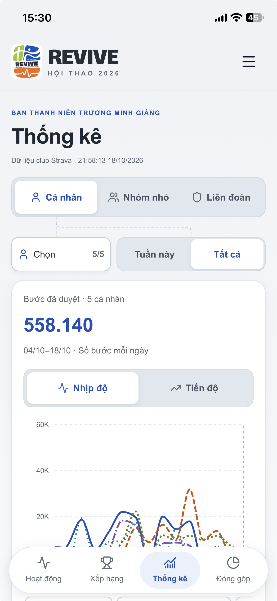
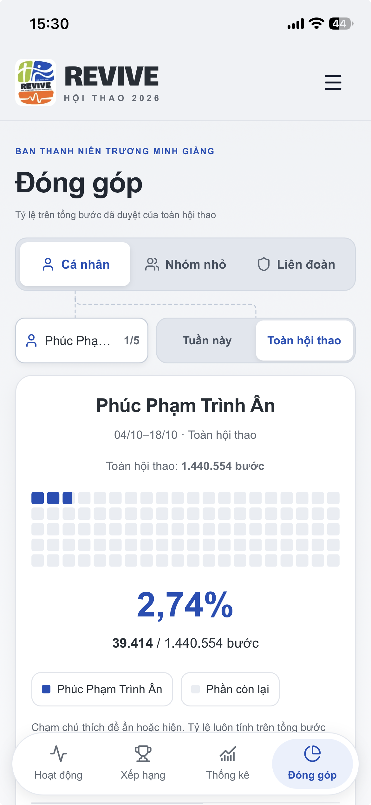
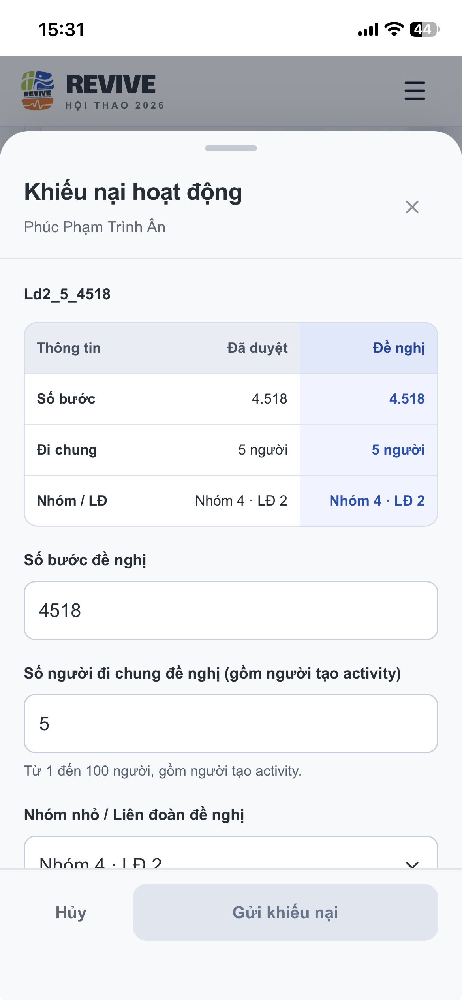
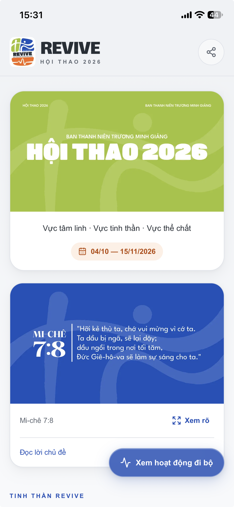
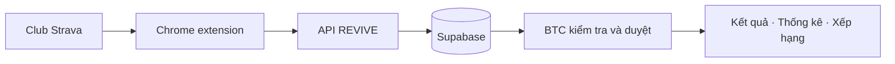

<p align="center">
  
</p>

<h1 align="center">REVIVE</h1>
<p align="center"><strong>Mỗi bước chân, một hành trình chung.</strong></p>
<p align="center">
  Từ những bài đi bộ trên Strava đến kết quả Hội thao mà mọi người có thể cùng theo dõi.
</p>

<p align="center">
  <a href="https://btn-tmg-strava-tracker.vercel.app"><strong>Trải nghiệm REVIVE ↗</strong></a>
  &nbsp;·&nbsp;
  <a href="https://github.com/phuc-an-dev/btn-tmg-strava-crawler-extension">Repo Chrome extension</a>
  &nbsp;·&nbsp;
  <a href="#chạy-ở-máy-cá-nhân">Chạy ở máy cá nhân</a>
</p>

<p align="center">
  Next.js 16 · React 19 · TypeScript · Supabase · Tailwind CSS 4
</p>

<p align="center">
  <a href="docs/screenshots/activities.png"></a>
  <a href="docs/screenshots/rankings.png"></a>
  <a href="docs/screenshots/statistics.png"></a>
</p>

<p align="center"><strong>Hoạt động</strong> · Theo dõi trạng thái và điểm<br><strong>Xếp hạng</strong> · Biết vị trí của mình<br><strong>Thống kê</strong> · So sánh nhịp độ giữa các thành viên</p>

<p align="center">
  <a href="docs/screenshots/contributions.png"></a>
  <a href="docs/screenshots/appeals.png"></a>
  <a href="docs/screenshots/about.png"></a>
</p>

<p align="center"><strong>Đóng góp</strong> · Nhìn thấy phần mình trong kết quả chung<br><strong>Khiếu nại</strong> · Gửi đề nghị đối chiếu hoạt động<br><strong>Giới thiệu</strong> · Khám phá tinh thần REVIVE</p>

<p align="center"><sub>6 ảnh chụp thực tế ngày 19/10/2026. Nhấn vào từng ảnh để xem đầy đủ; số liệu là tại thời điểm chụp.</sub></p>

REVIVE là web app theo dõi bộ môn đi bộ của Hội thao Ban Thanh Niên Trương Minh Giảng: giúp thành viên nhìn lại thành quả, giúp Ban Tổ Chức (BTC) giảm công việc đối chiếu và tập trung kết quả về một nơi.

**Khám phá:** [Câu chuyện dự án](#vì-sao-có-revive) · [Chức năng](#các-chức-năng-chính) · [Luồng dữ liệu](#hai-repo-phối-hợp-như-thế-nào) · [Công nghệ](#công-nghệ) · [Đóng góp](#dữ-liệu-và-đóng-góp)

## Vì sao có REVIVE?

Hội thao BTN thường diễn ra vào tháng 10–11, với 10 nhóm nhỏ được chia vào 5 liên đoàn. Bộ môn đi bộ ghi nhận số bước của từng người và cộng điểm khi đi chung để khuyến khích sự gắn kết.

Năm 2025, club Strava có hơn 600 bài đăng. Việc kiểm tra từng bài, xuất CSV, tổng hợp Google Sheets và trả lời các câu hỏi về kết quả tốn rất nhiều thời gian. Thành viên cũng khó tìm lại bài, biết bài nào đã được duyệt hoặc theo dõi thành tích của nhóm mình.

REVIVE ra đời từ nhu cầu đó. Phiên bản đầu được mình thực hiện trong một tuần ngoài giờ làm việc, từ ý tưởng, chia nhỏ công việc, giao diện và dữ liệu đến triển khai, kiểm thử và sửa lỗi. Dự án có sự hỗ trợ của AI trong quá trình phát triển và biên soạn tài liệu; các quyết định về nghiệp vụ và việc kiểm tra kết quả do người phát triển thực hiện.

## Các chức năng chính

### Dành cho người tham gia và người theo dõi

- **Tra cứu hoạt động:** xem bài đi bộ, trạng thái duyệt và các bài cần bổ sung; mở nhanh bài gốc trên Strava để đối chiếu.
- **Xếp hạng:** theo dõi cá nhân, nhóm nhỏ, liên đoàn; xem theo tuần hoặc toàn Hội thao, với bộ lọc giới tính ở bảng cá nhân. Top Kudo được theo dõi riêng.
- **Thống kê:** xem nhịp độ theo ngày và tiến độ tích lũy; so sánh tối đa 5 cá nhân, nhóm nhỏ hoặc liên đoàn.
- **Đóng góp và vinh danh:** xem phần đóng góp số bước và bảng vinh danh; có chế độ trình chiếu cho phần vinh danh.
- **Khiếu nại:** thành viên đăng nhập có thể gửi yêu cầu đối chiếu hoạt động và theo dõi phản hồi của BTC.
- **Thông tin Hội thao:** trang giới thiệu trình bày thông điệp, câu gốc, lịch trình và thành viên BTC.

### Dành cho BTC

- Duyệt đăng ký, liên kết tài khoản với thành viên Strava, phân nhóm nhỏ/liên đoàn và quản lý vai trò.
- Duyệt hoạt động, kiểm tra số bước và số người đi chung, ghi chú điều chỉnh, chấp nhận hoặc từ chối.
- Tiếp nhận khiếu nại, đối chiếu đề xuất với dữ liệu hiện tại và cập nhật kết quả kèm lý do xử lý.
- Theo dõi lịch sử thao tác qua Audit.
- Nhận thông báo đăng ký và khiếu nại mới qua chuông trong app; hỗ trợ email và Web Push khi được cấu hình.

Các trang thành viên, hoạt động, xếp hạng, thống kê, đóng góp và vinh danh có chế độ xem công khai. Các thao tác cá nhân và quản trị yêu cầu đăng nhập, liên kết tài khoản hoặc quyền tương ứng. Quyền dữ liệu được kiểm soát tại Supabase bằng RLS và các RPC, ngoài kiểm tra giao diện.

## Dùng trên điện thoại

REVIVE ưu tiên giao diện điện thoại và hỗ trợ mở từ màn hình chính:

- **iPhone/iPad:** mở bằng Safari → Chia sẻ → Thêm vào Màn hình chính.
- **Android:** mở bằng Chrome → menu → Cài đặt ứng dụng hoặc Thêm vào màn hình chính, tùy trình duyệt.

Đây là web app, cần kết nối mạng để tải dữ liệu. Service worker hiện phục vụ thông báo, không cung cấp chế độ dùng ngoại tuyến. Liên kết Strava sẽ mở bên ngoài app.

## Hai repo phối hợp như thế nào?



- **Repo này:** giao diện web, API nhận đồng bộ, xác thực, nghiệp vụ duyệt và cơ sở dữ liệu.
- **[Repo extension](https://github.com/phuc-an-dev/btn-tmg-strava-crawler-extension):** công cụ dành cho người được BTC cấp quyền đồng bộ, chạy trong trình duyệt đã đăng nhập Strava.

Đồng bộ được khởi động từ extension; web không tự lấy dữ liệu Strava theo lịch. Dữ liệu mới nhập ở trạng thái chờ duyệt, chưa được tính điểm.

## Cách ghi nhận kết quả

Bản hiện tại dành cho Hội thao 2026, với khoảng thời gian hoạt động **04/10/2026–15/11/2026**, theo giờ Việt Nam.

- Chỉ hoạt động **Walk** hợp lệ và **đã duyệt** mới đóng góp vào kết quả thi đấu.
- Bảng cá nhân dùng số bước thực tế; bảng nhóm nhỏ/liên đoàn dùng điểm đã duyệt, có cộng thưởng đi chung.
- Đi một mình: điểm bằng số bước. Từ 2 người: `round(số bước × (1 + số người / 10))`. Số người bao gồm người tạo hoạt động.
- Thống kê dùng bước thực tế đã duyệt đến hết hôm qua, không cộng thưởng đi chung.
- Kudo được theo dõi riêng, không cộng vào điểm đi bộ.
- Bài thiếu activity đính kèm nằm trong **Cần bổ sung**, không được suy ra số bước từ tiêu đề để tính điểm.
- Việc đổi trạng thái duyệt hoặc xử lý khiếu nại có thể làm kết quả thay đổi.

## Công nghệ

| Thành phần | Công nghệ |
| --- | --- |
| Web | Next.js 16, React 19, TypeScript |
| Giao diện | Tailwind CSS 4, Base UI, Lucide |
| Biểu đồ và bộ lọc URL | Recharts, nuqs |
| Dữ liệu và xác thực | Supabase PostgreSQL, Auth, RLS, RPC |
| Triển khai | Vercel |
| Email thông báo BTC | Resend |
| Thông báo thiết bị | Web Push, VAPID |

Email OTP đăng ký do Supabase Auth gửi qua cấu hình SMTP của dự án. Email thông báo BTC dùng luồng Resend riêng.

## Chạy ở máy cá nhân

### Yêu cầu

- Node.js 20.9 trở lên và npm; nên dùng bản Node LTS đáp ứng yêu cầu của dependency.
- Một dự án Supabase riêng cho phát triển, với schema và cấu hình Auth phù hợp.

```bash
git clone https://github.com/phuc-an-dev/btn-tmg-strava-tracker.git
cd btn-tmg-strava-tracker
npm ci
cp .env.example .env.local
```

Điền hai biến để kết nối Supabase:

```dotenv
NEXT_PUBLIC_SUPABASE_URL=https://your-project.supabase.co
NEXT_PUBLIC_SUPABASE_PUBLISHABLE_KEY=your-publishable-key
```

Sau đó:

```bash
npm run dev
```

Mở [localhost:3000](http://localhost:3000). Trang `/about` giới thiệu Hội thao; các trang có dữ liệu cần Supabase được thiết lập đầy đủ. Repo không kèm dữ liệu thành viên thật hoặc tài khoản quản trị dùng thử.

### Thiết lập Supabase

SQL nằm trong `supabase/migrations/`, các bài kiểm tra cơ sở dữ liệu nằm trong `supabase/tests/`.

Đây là mã nguồn của một ứng dụng đang vận hành, chưa phải bộ mẫu có thể dựng đầy đủ bằng một lệnh. Trước khi áp dụng lên dự án riêng:

1. Rà soát migrations theo thứ tự phụ thuộc, đặc biệt phần khởi tạo admin và cấu hình dành riêng cho Hội thao.
2. Kiểm tra version migration: hiện có hai tệp cùng tiền tố `202610140001`. Cần xử lý cách định danh trên bản sao phát triển trước khi dùng công cụ áp dụng migration; không đổi lịch sử của hệ thống đang chạy một cách tùy tiện.
3. Cấu hình Auth Site URL, redirect URL cho localhost và môi trường triển khai. Bật xác nhận email, thiết lập SMTP và mẫu OTP 6 chữ số trong `supabase/templates/confirmation.html`.
4. Chuẩn bị danh sách thành viên, nhóm nhỏ/liên đoàn và quyền admin cho môi trường của bạn. Xác nhận email không đồng nghĩa với việc đăng ký đã được BTC duyệt.

`supabase/config.toml` ghi nhận cấu hình OTP dự kiến; không thay thế việc kiểm tra cấu hình thực tế trên Supabase hosted.

### Các tích hợp tùy chọn

| Biến môi trường server | Mục đích |
| --- | --- |
| `STRAVA_SYNC_SECRET` | Xác thực yêu cầu đồng bộ từ extension |
| `RESEND_API_KEY`, `ADMIN_EMAIL_FROM` | Gửi email thông báo BTC |
| `ADMIN_EMAIL_WORKER_SECRET` | Xác thực worker gửi thông báo |
| `VAPID_PUBLIC_KEY`, `VAPID_PRIVATE_KEY` | Web Push cho thiết bị admin |

Xem tên biến đầy đủ trong [`.env.example`](.env.example). Không thêm tiền tố `NEXT_PUBLIC_` cho khóa bí mật.

- **Đồng bộ:** ngoài biến server, cấu hình SHA-256 của cùng mã bí mật trong `private.extension_sync_config`; mã phải có ít nhất 32 ký tự. Chỉ cấp mã cho người vận hành được phép đồng bộ.
- **Email/Web Push:** cần các migrations thông báo, cấu hình private settings, worker URL, Vault và lịch pg_cron tương ứng. Chỉ đặt biến môi trường chưa đủ để bật các kênh này. Web Push còn cần người dùng chủ động cấp quyền trên thiết bị hỗ trợ.
- **Môi trường phát triển:** dùng project, khóa và người nhận thử riêng; chỉ bật gửi sau khi đã cấu hình và kiểm tra luồng tương ứng.

## Kiểm tra và triển khai

```bash
npm run lint
npm run typecheck
node --test tests/*.test.mjs
npm run build
```

Các tệp `supabase/tests/*.sql` cần chạy riêng trên cơ sở dữ liệu thử nghiệm đã có schema tương ứng; lệnh Node không chạy chúng. Đọc từng tệp trước khi thực thi.

Có thể triển khai trên Vercel sau khi chuẩn bị database, biến môi trường và Auth redirect URL. Với bản fork, cần thay địa chỉ website, endpoint của extension, club ID, thời gian Hội thao và các cấu hình thương hiệu liên quan. Các giá trị này hiện nằm ở nhiều tệp, chưa có một màn hình cấu hình chung.

Build thành công chỉ xác nhận việc biên dịch. Cần kiểm tra riêng đăng ký/OTP, đồng bộ, duyệt, khiếu nại, kết quả và các kênh thông báo trên môi trường của bạn.

## Cấu trúc thư mục

```text
src/app/              Trang Next.js và API routes
src/components/       Giao diện và các màn hình nghiệp vụ
src/lib/              Kiểu dữ liệu, tiện ích và xử lý phía ứng dụng
supabase/migrations/  Schema, RLS và RPC
supabase/tests/       Kiểm tra cơ sở dữ liệu
supabase/templates/   Mẫu email Auth
public/               Hình ảnh, manifest assets và service worker
scripts/              Công cụ hỗ trợ
tests/               Kiểm tra bằng Node.js
```

## Dữ liệu và đóng góp

Không đưa `.env.local`, mã đồng bộ, API key, bản xuất dữ liệu hoặc thông tin cá nhân thành viên vào commit, issue hay ảnh chụp công khai. Thư mục `exports/` và seed danh sách thành viên đã được loại khỏi Git.

Nếu muốn góp ý hoặc báo lỗi, bạn có thể [mở issue](https://github.com/phuc-an-dev/btn-tmg-strava-tracker/issues) với mô tả, bước tái hiện và ảnh đã che thông tin cá nhân. Khi gửi thay đổi, hãy mô tả mục đích và cách kiểm tra; ưu tiên dùng dữ liệu giả lập.

REVIVE là dự án cộng đồng dành cho Hội thao BTN Trương Minh Giảng, không phải sản phẩm chính thức của Strava.
